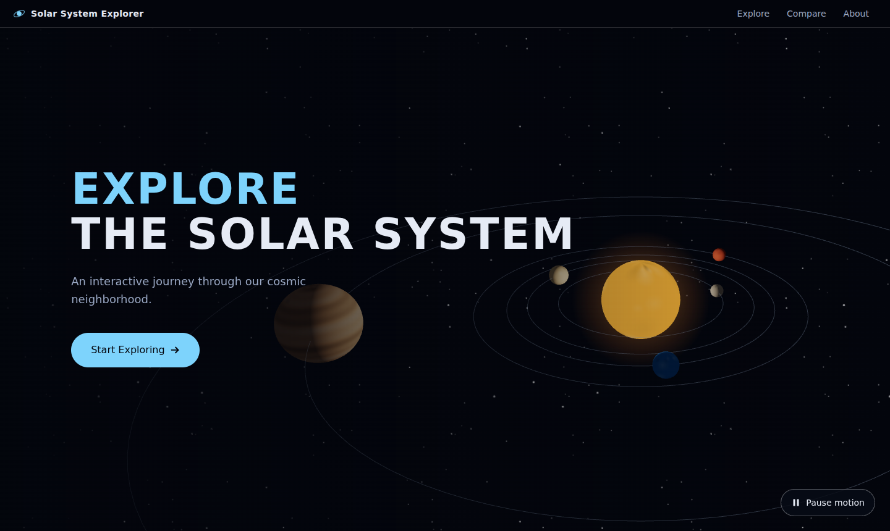
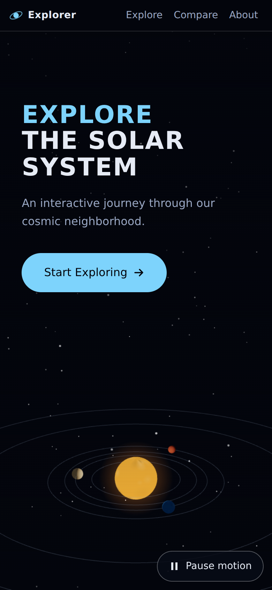
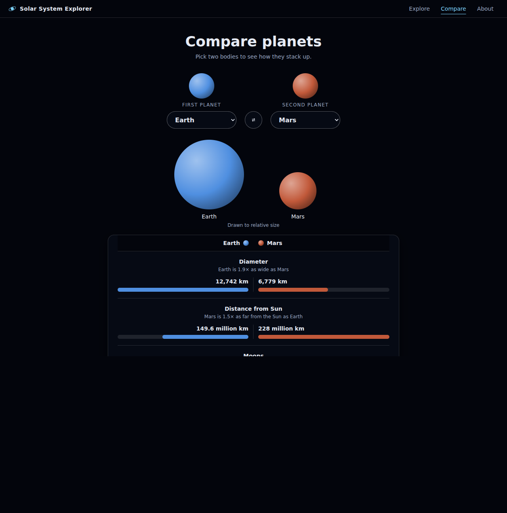
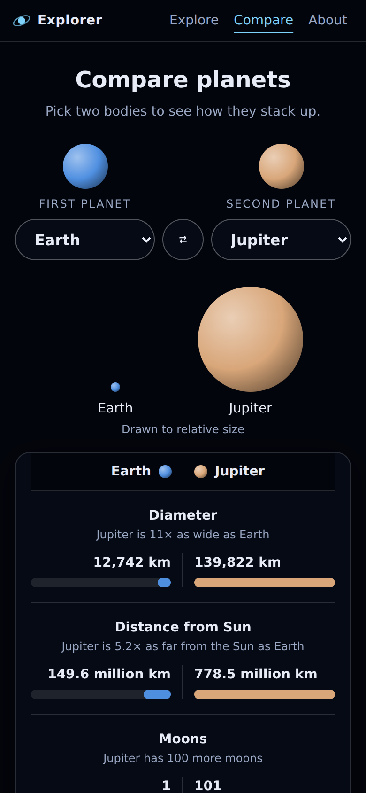
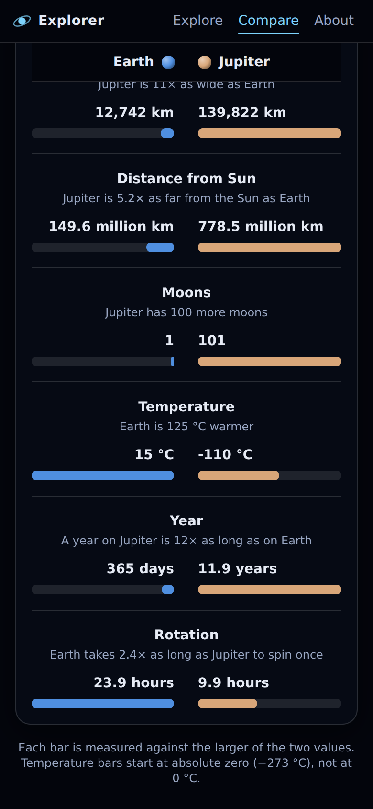
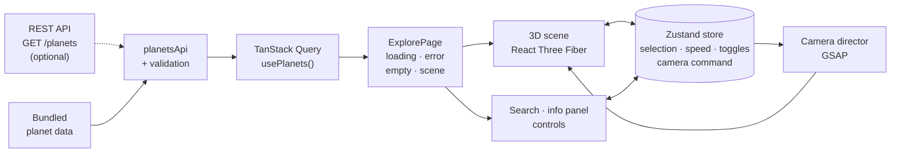
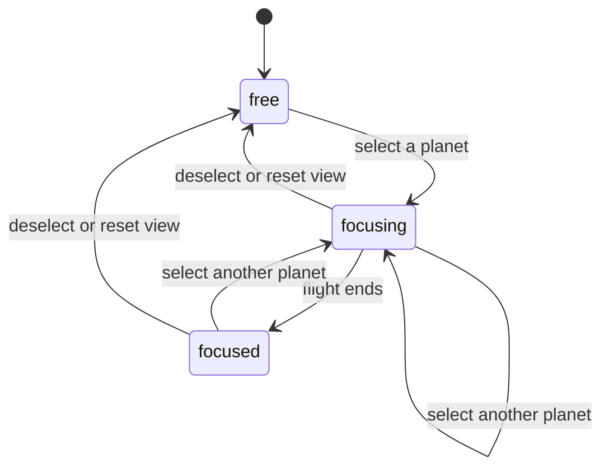

<div align="center">


# Solar System Explorer

**An interactive 3D journey through our solar system, right in your browser.**

<p>
  
  
  
  
  
  
  
  
  
</p>


</div>

<!-- After pushing to GitHub, add a CI badge here:
[](https://github.com/<user>/<repo>/actions/workflows/ci.yml)
-->

## About

Solar System Explorer is a web app for exploring the Sun and the eight planets in 3D. Orbit the camera, pick a planet by clicking it or searching for it, and the camera flies there while an information panel shows its key facts. You can pause the simulation, change its speed from 0.1× to 100×, and toggle orbit lines, labels and the star field.

It is built as a portfolio-grade project: a typed data layer with validation, a clear split between client state and server state, a camera system with smooth transitions, and a responsive UI that works on phones as well as desktops.

> **Not to scale.** A true-to-scale solar system is unusable on a screen (Neptune is about 78× farther out than Mercury). Distances, sizes and spin rates are compressed with documented power curves so every body stays visible. Order, relative size and orbital-period ratios are preserved. See [`visualScale.ts`](src/features/solar-system/data/visualScale.ts).

## Project status

This project is built in phases. Phases 1–13 are complete.

| Area                                         | Status     |
| -------------------------------------------- | ---------- |
| 3D scene, selection, camera, simulation      | ✅ Done    |
| Search, information panel, responsive layout | ✅ Done    |
| State management (Zustand)                   | ✅ Done    |
| Data layer (TanStack Query, optional API)    | ✅ Done    |
| Planet comparison page (`/compare`)          | ✅ Done    |
| Landing page (`/`)                           | ✅ Done    |
| About page (`/about`)                        | 🚧 Planned |
| Performance and accessibility audits         | ✅ Done    |

The About route currently shows a placeholder. The 3D experience lives at `/explore`.

## Screenshots

### Landing

<table>
  <tr>
    <td width="68%" valign="top"></td>
    <td width="32%" align="center" valign="top"></td>
  </tr>
  <tr>
    <td align="center"><sub>Desktop: text on the left, a live partial 3D preview on the right</sub></td>
    <td align="center"><sub>Phone: text on top, preview below</sub></td>
  </tr>
</table>

### Explore

<table>
  <tr>
    <td width="50%"></td>
    <td width="50%"></td>
  </tr>
  <tr>
    <td align="center"><sub>Focus on a planet: smooth camera flight and details panel</sub></td>
    <td align="center"><sub>Search with ranked results (prefix matches first)</sub></td>
  </tr>
</table>

<table>
  <tr>
    <td width="50%" align="center"></td>
    <td width="50%" align="center"></td>
  </tr>
  <tr>
    <td align="center"><sub>Mobile: the scene keeps the screen</sub></td>
    <td align="center"><sub>Mobile: details stack below the scene</sub></td>
  </tr>
</table>

### Comparison

<p align="center">
  
</p>

<table>
  <tr>
    <td width="50%" align="center"></td>
    <td width="50%" align="center"></td>
  </tr>
  <tr>
    <td align="center"><sub>Mobile: two pickers and a to-scale size picture</sub></td>
    <td align="center"><sub>The names stay pinned while the rows scroll</sub></td>
  </tr>
</table>

## Features

**3D scene**

- The Sun and eight planets as reusable components, with Saturn's rings (including the Cassini division)
- Surface textures drawn procedurally on a canvas, so there are no image downloads
- The Sun has an emissive surface, a glow and a point light
- Orbit lines, planet labels and a star field, each with its own toggle
- Hover highlight and a selection ring; planets are also reachable by keyboard

**Camera**

- Three states: `free`, `focusing`, `focused`
- GSAP-driven flights that arc over the Sun instead of passing through it
- A camera that never ends up inside a body, plus a **Reset view** button and <kbd>Esc</kbd> to deselect

**Simulation**

- Play and pause, with seven speeds from 0.1× to 100×
- Real orbital-period ratios; Venus and Uranus spin backwards
- Speed changes never make planets jump, and a background tab never teleports them

**Landing page**

- A hero with the title, a subtitle and a **Start Exploring** button, built up by GSAP in reading order (title lines rise out of a mask, then the subtitle, then the button)
- A starry background with slow, two-layer drift, and a live, cropped 3D view of the inner solar system behind the text
- The preview shares the simulation clock with Explore, so the planets are where you find them after you click through
- The preview is optional in every way: it starts only after the hero has finished animating, and without WebGL, planet data or its code the page simply shows the stars
- Hovering or focusing the button loads the Explore page early, so the click feels instant

**Comparison**

- Pick any two bodies, or swap them; the pair lives in the URL (`/compare?a=earth&b=mars`), so a link, a refresh and the back button all keep it
- The **Compare** button on a planet in Explore opens that planet against Earth (or Earth against Mars)
- Both bodies drawn to true relative size, then side-by-side bars for diameter, distance, moons, temperature, year and rotation
- A plain sentence for every row ("Earth is 1.9× as wide as Mars"); values that do not apply (the Sun has no moons) show a dash
- Temperature bars start at absolute zero, so a body colder than 0 °C still gets an honest bar

**Interface**

- Search with ranked results, and an information panel with formatted facts
- Responsive layout: stacked on phones, floating panels on wide or landscape screens
- Touch-friendly controls (44 px targets)
- Respects `prefers-reduced-motion` (the simulation starts paused and entrance animations are skipped)
- Friendly fallback when WebGL is unavailable

**Data**

- Planet data comes through TanStack Query with loading, error and empty states
- Works offline from bundled data, or from a REST API by setting one environment variable
- Every API response is validated before use; bad data shows an error instead of breaking the scene

## Tech stack

| &nbsp;                                                                                                                      | Technology                                    | Used for                                                     |
| --------------------------------------------------------------------------------------------------------------------------- | --------------------------------------------- | ------------------------------------------------------------ |
|                                                                    | **React 19**                                  | UI components                                                |
|                                                          | **TypeScript** (strict)                       | Type safety across data, services and the scene              |
|                                                                      | **Vite 8**                                    | Dev server and production build                              |
|                                                               | **Three.js**, **React Three Fiber**, **drei** | The 3D scene                                                 |
|                                                                      | **GSAP**                                      | Camera flights and panel entrances (visual transitions only) |
|                                                                | **Zustand**                                   | Client state                                                 |
|                                                        | **TanStack Query**                            | Server state: fetching, caching, retries                     |
|                                                      | **React Router**                              | Routing and lazy-loaded pages                                |
|                                                       | **Tailwind CSS 4**                            | Styling with design tokens                                   |
|                                                                  | **Vitest**                                    | Unit tests                                                   |
|   | **ESLint**, **Prettier**                      | Linting and formatting                                       |
|                                                  | **GitHub Actions**                            | CI: type-check, lint, format, test, build                    |

## Architecture

### Data flow



### Camera states



### Zustand vs TanStack Query

The two libraries solve different problems, so each owns a clearly separate kind of state.

|                   | Zustand                                                                  | TanStack Query                                       |
| ----------------- | ------------------------------------------------------------------------ | ---------------------------------------------------- |
| **Owns**          | Client state: what the person is doing                                   | Server state: data that lives somewhere else         |
| **Examples here** | Selected planet, pause, speed, orbit/label/star toggles, camera requests | The planet list                                      |
| **Handles**       | Synchronous updates shared across components                             | Fetching, caching, retries, loading and error states |
| **Never holds**   | API responses or the planet database                                     | UI state                                             |

GSAP sits beside both: React and Zustand decide **what** should happen, GSAP decides **how the transition looks**.

A third place holds one more kind of state: **the URL**. Which two bodies are being compared is not stored in Zustand but in the query string, because a comparison is something people want to share, bookmark and reload. The ids in the URL are untrusted input, so they are checked against the real planet list and anything unknown falls back to a sensible pair.

### Folder structure

```text
src/
├── app/            App shell, providers, router
├── components/     Shared UI: layout, common states, buttons, icons
├── features/
│   ├── solar-system/   3D scene, camera, simulation (components, hooks, data, utils)
│   ├── planets/        Information panel, planet data gate and value formatting
│   ├── comparison/     Planet comparison page (pair from the URL, bars, size picture)
│   ├── landing/        Landing page: hero, starfield, 3D preview
│   └── search/         Planet search
├── hooks/          Shared hooks, including hooks/queries (TanStack Query)
├── pages/          Route components
├── services/       API client, response validation, planets service
├── store/          Zustand store
├── data/           Bundled planet data (NASA fact sheet values)
├── types/          Shared types
├── utils/          Shared helpers
└── styles/         Design tokens and global styles
```

## Getting started

**Requirements:** Node.js 22.12 or newer and npm.

```bash
git clone https://github.com/<your-username>/solar-system-explorer.git
cd solar-system-explorer
npm install
npm run dev
```

Then open the URL that Vite prints (usually <http://localhost:5173>) and go to **Explore**.

### Scripts

| Command                | What it does                               |
| ---------------------- | ------------------------------------------ |
| `npm run dev`          | Start the dev server                       |
| `npm run build`        | Type-check, then create a production build |
| `npm run preview`      | Serve the production build locally         |
| `npm run typecheck`    | Type-check the app and the Vite config     |
| `npm run lint`         | Run ESLint                                 |
| `npm test`             | Run the unit tests once                    |
| `npm run test:watch`   | Run the unit tests in watch mode           |
| `npm run format`       | Format everything with Prettier            |
| `npm run format:check` | Check formatting without changing files    |

### Environment variables

Copy `.env.example` to `.env` if you want to use a real API. Leave the value empty to use the bundled data.

| Variable            | Default | Description                                                                   |
| ------------------- | ------- | ----------------------------------------------------------------------------- |
| `VITE_API_BASE_URL` | empty   | Base URL of a planets API, without a trailing slash. Empty uses bundled data. |

> Variables that start with `VITE_` are bundled into the browser code and are public. Never put secrets in them.

### API contract

With `VITE_API_BASE_URL` set, the app calls `GET {VITE_API_BASE_URL}/planets` and expects a JSON array. The server must allow the app's origin through CORS. Each item looks like this:

```json
{
  "id": "earth",
  "name": "Earth",
  "type": "planet",
  "radius": 6371,
  "distanceFromSun": 149.6,
  "orbitalPeriod": 365.2,
  "rotationPeriod": 23.9,
  "temperature": 15,
  "moons": 1,
  "description": "Our home and the only place known to support life.",
  "color": "#4f8fe0"
}
```

| Field                          | Rule                                                             |
| ------------------------------ | ---------------------------------------------------------------- |
| `id`                           | Unique; lowercase letters, digits and `-` only                   |
| `type`                         | `star`, `planet` or `dwarf-planet`                               |
| `radius` (km)                  | Number greater than 0                                            |
| `distanceFromSun` (million km) | Greater than 0 for anything that orbits; 0 is allowed for a star |
| `orbitalPeriod` (days)         | Greater than 0 for anything that orbits; 0 is allowed for a star |
| `rotationPeriod` (hours)       | Not 0; negative means the body spins backwards                   |
| `temperature` (°C)             | At or above −273.15                                              |
| `moons`                        | Whole number, 0 or more                                          |
| `color`                        | `#rrggbb`                                                        |
| `name`, `description`          | Non-empty text                                                   |

Responses that break these rules are rejected with a friendly error instead of reaching the scene. Network errors, timeouts, `5xx`, `408` and `429` are retried once; a `404` or invalid data is not.

## Testing and quality

Every change is checked by the same commands that CI runs:

```bash
npm run typecheck      # TypeScript, strict mode
npm run lint           # ESLint
npm run format:check   # Prettier
npm test               # Vitest
npm run build          # Production build
```

The unit tests cover the logic that is easiest to get subtly wrong: response validation and retry rules, the API client (success, HTTP errors, network errors, timeouts, cancellation), value formatting, search ranking, orbit and spin maths, the simulation clock, the visual scale, camera framing and paths, the Zustand store, the integrity of the bundled planet data, the comparison logic (choosing a safe pair from a URL, bar lengths, the one-sentence summaries), and the landing page's camera placement, preview selection and generated starfield.

> `npx tsc --noEmit` on its own checks nothing in this repository: the root `tsconfig.json` only lists project references. Use `npm run typecheck`, which builds both referenced projects.

## Accessibility

- **Keyboard.** Every action works without a pointer. A "Skip to main content" link comes first. Planets are reachable through the labels in the scene or through search. Labels that are off screen are left out of the tab order, because a focused control nobody can see is a lost keyboard user; search still reaches every planet, and Reset view brings them all back. Closing the details panel returns focus to the planet, and after navigating, focus moves to the page and scroll returns to the top.
- **Screen readers.** Landmarks (`header`, `nav`, `main`), one `h1` per page, a title for every route, announcements for the selected planet and for the number of search results, the combobox pattern for search, and `aria-pressed` on every toggle. The canvas itself is hidden from assistive technology: the labels are the real controls.
- **Motion.** `prefers-reduced-motion` is respected everywhere: the simulation starts paused, camera moves become jumps, and no CSS animation runs. Outside that setting, both the landing page and Explore have a Pause button.
- **Contrast and size.** Text meets WCAG AA (4.5:1, or 3:1 for large text), measured against what is actually drawn behind it, including the 3D scene. Controls are at least 44 px tall except the planet labels (24 px, floating over the scene), whose 44 px alternative is the search box. Nothing scrolls sideways at 320 px wide.

How it was checked: axe-core on every route, at phone and desktop sizes and in the interesting states (no violations), scripted keyboard walk-throughs, and the pixel-based contrast measurement. These checks ran by hand; they are not part of CI. Real screen readers (NVDA, VoiceOver, TalkBack) have not been tried.

## Performance notes

- Pixel density is capped at 2× so phones with very sharp screens do not overload the GPU.
- Panels use no backdrop blur, because that would re-blur the live WebGL canvas every frame.
- Simulated time is a plain object advanced each frame outside React, so the scene never re-renders 60 times a second.
- Planets are memoized and share geometries; surface textures are generated, not downloaded.
- Pages are code-split by route. three.js and React Three Fiber sit in their own chunk (about 240 kB gzipped) that changes only when those libraries do, so a deploy that touches app code leaves it in the browser cache. The landing page downloads it only after the hero has finished animating, and skips it when WebGL is unavailable.
- While the simulation is paused, the Explore canvas draws only when something changes (a hover, a toggle, a camera move). A paused, untouched scene costs no GPU time and no battery. A camera flight still renders every frame.
- Resources are released when a 3D page unmounts, and visiting the pages repeatedly leaves the number of renderers, DOM nodes and event listeners unchanged. Planets use Lambert materials rather than PBR ones: they are matte and lit only by the Sun, so PBR added shader cost and nothing visible, and three.js r186 keeps every renderer that draws a PBR material alive through a shared lookup texture.
- Surface textures are 512×256 (about 6 MB of GPU memory for the whole Explore scene). When the camera focuses on a planet it fills most of a phone screen and only half the texture wraps into view (256 texels across), so they were not reduced further.
- The landing starfield is one small tiled SVG per layer, and its slow drift advances in a few steps per second instead of every frame. Stacking a gradient per star made the page paint at under 1 frame per second on a CPU-rendered browser; this version is a plain image blit.
- Decoration never competes with content: the 3D preview waits for the hero entrance, runs at a lower pixel density than Explore, and draws once and stops when the simulation is paused (including under reduced motion).

## Known limitations

- The 3D vendor chunk is about 910 kB (about 241 kB gzipped), almost all of it three.js itself, which cannot be split further. It loads lazily, and `chunkSizeWarningLimit` is set to 1 MB so the build still warns if it ever grows past that.
- The console shows a `THREE.Clock` deprecation notice. It comes from React Three Fiber 9.8.1 (the latest release) and goes away when that library moves to `THREE.Timer`.
- Because of the compressed visual scale, Venus and Earth, and Jupiter and Saturn's rings, sit closer together than their combined sizes, so they can briefly overlap when they line up.
- The camera can be moved freely only by mouse or touch (drag, pinch, scroll). By keyboard, choosing a planet flies the camera to it, and Reset view returns to the overview.
- Earth has no atmosphere or Moon yet.
- Moon counts are from early 2026 and change as new moons are confirmed.

## Roadmap

- [x] Planet comparison page, with side-by-side facts and visual indicators
- [x] Landing page with GSAP entrance animations
- [ ] Earth atmosphere and the Moon
- [ ] Staged loading screen
- [x] Performance audit (render performance, bundle size, mobile)
- [x] Accessibility audit (keyboard, focus, ARIA, reduced motion)
- [ ] Final QA pass

## Acknowledgements

- Planet data: [NASA Planetary Fact Sheet](https://nssdc.gsfc.nasa.gov/planetary/factsheet/).
- Technology logos: [Simple Icons](https://simpleicons.org/) (CC0). All logos are trademarks of their respective owners. The Zustand tile is a plain monogram, because Simple Icons has no Zustand logo.
