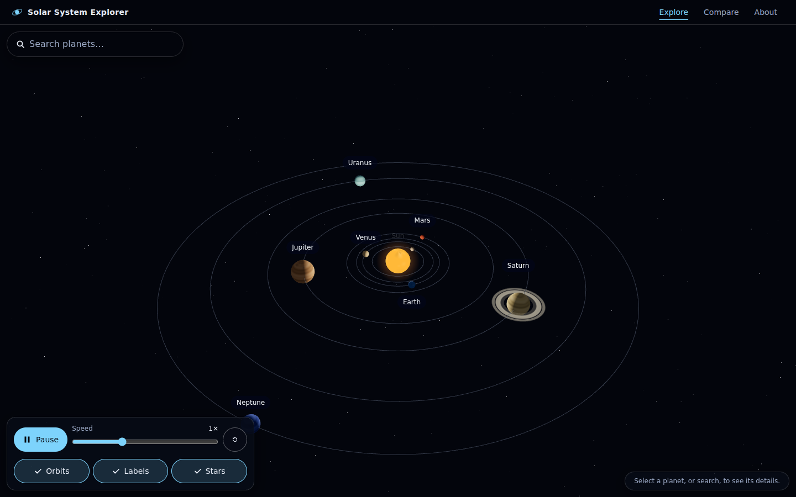
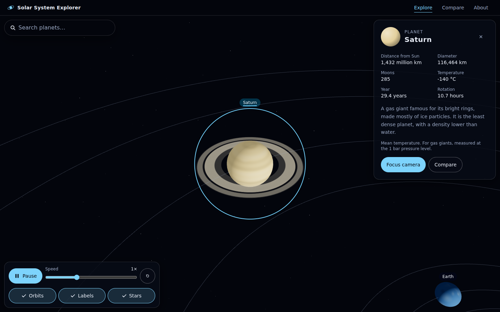
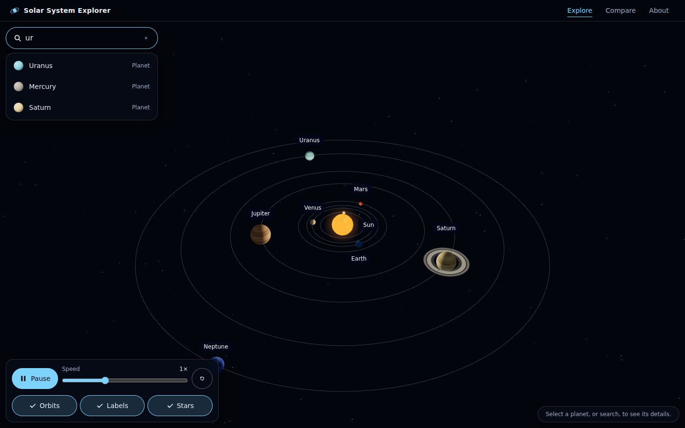
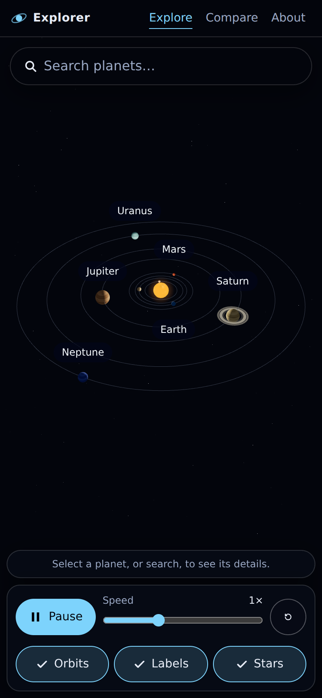
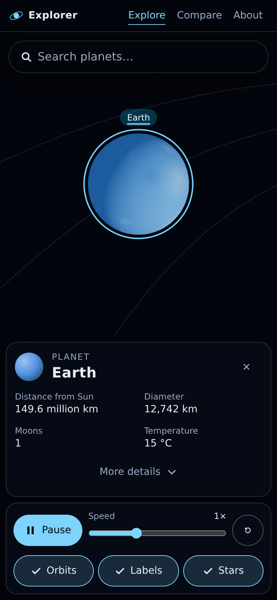
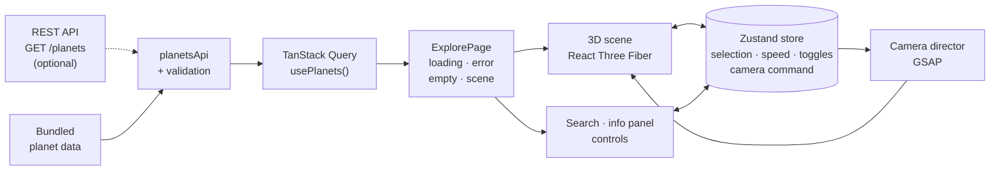
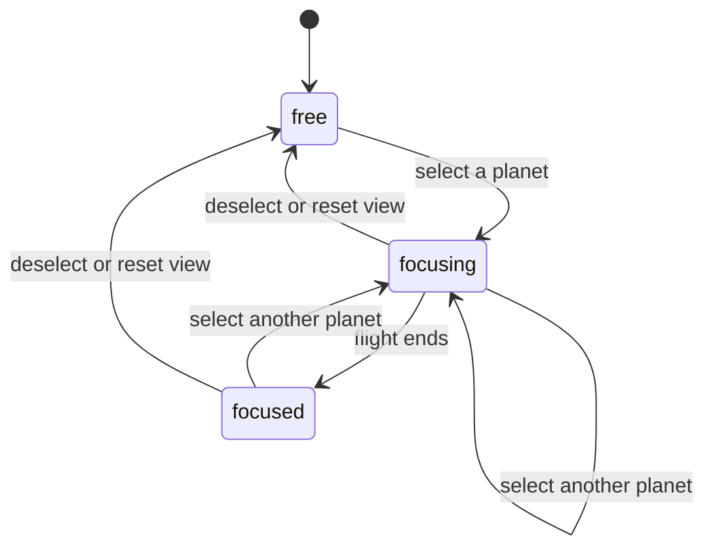

<div align="center">


# Solar System Explorer

**An interactive 3D journey through our solar system, right in your browser.**

<p>
  
  
  
  
  
  
  
  
  
</p>



</div>

<!-- After pushing to GitHub, add a CI badge here:
[](https://github.com/<user>/<repo>/actions/workflows/ci.yml)
-->

## About

Solar System Explorer is a web app for exploring the Sun and the eight planets in 3D. Orbit the camera, pick a planet by clicking it or searching for it, and the camera flies there while an information panel shows its key facts. You can pause the simulation, change its speed from 0.1× to 100×, and toggle orbit lines, labels and the star field.

It is built as a portfolio-grade project: a typed data layer with validation, a clear split between client state and server state, a camera system with smooth transitions, and a responsive UI that works on phones as well as desktops.

> **Not to scale.** A true-to-scale solar system is unusable on a screen (Neptune is about 78× farther out than Mercury). Distances, sizes and spin rates are compressed with documented power curves so every body stays visible. Order, relative size and orbital-period ratios are preserved. See [`visualScale.ts`](src/features/solar-system/data/visualScale.ts).

## Project status

This project is built in phases. Phases 1–9 are complete.

| Area                                         | Status     |
| -------------------------------------------- | ---------- |
| 3D scene, selection, camera, simulation      | ✅ Done    |
| Search, information panel, responsive layout | ✅ Done    |
| State management (Zustand)                   | ✅ Done    |
| Data layer (TanStack Query, optional API)    | ✅ Done    |
| Planet comparison page (`/compare`)          | 🚧 Planned |
| Landing page (`/`) and About page            | 🚧 Planned |
| Performance and accessibility audits         | 🚧 Planned |

The Home, Compare and About routes currently show placeholders. The 3D experience lives at `/explore`.

## Screenshots

<table>
  <tr>
    <td width="50%"></td>
    <td width="50%"></td>
  </tr>
  <tr>
    <td align="center"><sub>Focus on a planet: smooth camera flight and details panel</sub></td>
    <td align="center"><sub>Search with ranked results (prefix matches first)</sub></td>
  </tr>
</table>

<table>
  <tr>
    <td width="50%" align="center"></td>
    <td width="50%" align="center"></td>
  </tr>
  <tr>
    <td align="center"><sub>Mobile: the scene keeps the screen</sub></td>
    <td align="center"><sub>Mobile: details stack below the scene</sub></td>
  </tr>
</table>

## Features

**3D scene**

- The Sun and eight planets as reusable components, with Saturn's rings (including the Cassini division)
- Surface textures drawn procedurally on a canvas, so there are no image downloads
- The Sun has an emissive surface, a glow and a point light
- Orbit lines, planet labels and a star field, each with its own toggle
- Hover highlight and a selection ring; planets are also reachable by keyboard

**Camera**

- Three states: `free`, `focusing`, `focused`
- GSAP-driven flights that arc over the Sun instead of passing through it
- A camera that never ends up inside a body, plus a **Reset view** button and <kbd>Esc</kbd> to deselect

**Simulation**

- Play and pause, with seven speeds from 0.1× to 100×
- Real orbital-period ratios; Venus and Uranus spin backwards
- Speed changes never make planets jump, and a background tab never teleports them

**Interface**

- Search with ranked results, and an information panel with formatted facts
- Responsive layout: stacked on phones, floating panels on wide or landscape screens
- Touch-friendly controls (44 px targets)
- Respects `prefers-reduced-motion` (the simulation starts paused and entrance animations are skipped)
- Friendly fallback when WebGL is unavailable

**Data**

- Planet data comes through TanStack Query with loading, error and empty states
- Works offline from bundled data, or from a REST API by setting one environment variable
- Every API response is validated before use; bad data shows an error instead of breaking the scene

## Tech stack

| &nbsp;                                                                                                                      | Technology                                    | Used for                                                     |
| --------------------------------------------------------------------------------------------------------------------------- | --------------------------------------------- | ------------------------------------------------------------ |
|                                                                    | **React 19**                                  | UI components                                                |
|                                                          | **TypeScript** (strict)                       | Type safety across data, services and the scene              |
|                                                                      | **Vite 8**                                    | Dev server and production build                              |
|                                                               | **Three.js**, **React Three Fiber**, **drei** | The 3D scene                                                 |
|                                                                      | **GSAP**                                      | Camera flights and panel entrances (visual transitions only) |
|                                                                | **Zustand**                                   | Client state                                                 |
|                                                        | **TanStack Query**                            | Server state: fetching, caching, retries                     |
|                                                      | **React Router**                              | Routing and lazy-loaded pages                                |
|                                                       | **Tailwind CSS 4**                            | Styling with design tokens                                   |
|                                                                  | **Vitest**                                    | Unit tests                                                   |
|   | **ESLint**, **Prettier**                      | Linting and formatting                                       |
|                                                  | **GitHub Actions**                            | CI: type-check, lint, format, test, build                    |

## Architecture

### Data flow



### Camera states



### Zustand vs TanStack Query

The two libraries solve different problems, so each owns a clearly separate kind of state.

|                   | Zustand                                                                  | TanStack Query                                       |
| ----------------- | ------------------------------------------------------------------------ | ---------------------------------------------------- |
| **Owns**          | Client state: what the person is doing                                   | Server state: data that lives somewhere else         |
| **Examples here** | Selected planet, pause, speed, orbit/label/star toggles, camera requests | The planet list                                      |
| **Handles**       | Synchronous updates shared across components                             | Fetching, caching, retries, loading and error states |
| **Never holds**   | API responses or the planet database                                     | UI state                                             |

GSAP sits beside both: React and Zustand decide **what** should happen, GSAP decides **how the transition looks**.

### Folder structure

```text
src/
├── app/            App shell, providers, router
├── components/     Shared UI: layout, common states, buttons, icons
├── features/
│   ├── solar-system/   3D scene, camera, simulation (components, hooks, data, utils)
│   ├── planets/        Information panel and value formatting
│   └── search/         Planet search
├── hooks/          Shared hooks, including hooks/queries (TanStack Query)
├── pages/          Route components
├── services/       API client, response validation, planets service
├── store/          Zustand store
├── data/           Bundled planet data (NASA fact sheet values)
├── types/          Shared types
├── utils/          Shared helpers
└── styles/         Design tokens and global styles
```

## Getting started

**Requirements:** Node.js 22.12 or newer and npm.

```bash
git clone https://github.com/<your-username>/solar-system-explorer.git
cd solar-system-explorer
npm install
npm run dev
```

Then open the URL that Vite prints (usually <http://localhost:5173>) and go to **Explore**.

### Scripts

| Command                | What it does                               |
| ---------------------- | ------------------------------------------ |
| `npm run dev`          | Start the dev server                       |
| `npm run build`        | Type-check, then create a production build |
| `npm run preview`      | Serve the production build locally         |
| `npm run typecheck`    | Type-check the app and the Vite config     |
| `npm run lint`         | Run ESLint                                 |
| `npm test`             | Run the unit tests once                    |
| `npm run test:watch`   | Run the unit tests in watch mode           |
| `npm run format`       | Format everything with Prettier            |
| `npm run format:check` | Check formatting without changing files    |

### Environment variables

Copy `.env.example` to `.env` if you want to use a real API. Leave the value empty to use the bundled data.

| Variable            | Default | Description                                                                   |
| ------------------- | ------- | ----------------------------------------------------------------------------- |
| `VITE_API_BASE_URL` | empty   | Base URL of a planets API, without a trailing slash. Empty uses bundled data. |

> Variables that start with `VITE_` are bundled into the browser code and are public. Never put secrets in them.

### API contract

With `VITE_API_BASE_URL` set, the app calls `GET {VITE_API_BASE_URL}/planets` and expects a JSON array. The server must allow the app's origin through CORS. Each item looks like this:

```json
{
  "id": "earth",
  "name": "Earth",
  "type": "planet",
  "radius": 6371,
  "distanceFromSun": 149.6,
  "orbitalPeriod": 365.2,
  "rotationPeriod": 23.9,
  "temperature": 15,
  "moons": 1,
  "description": "Our home and the only place known to support life.",
  "color": "#4f8fe0"
}
```

| Field                          | Rule                                                             |
| ------------------------------ | ---------------------------------------------------------------- |
| `id`                           | Unique; lowercase letters, digits and `-` only                   |
| `type`                         | `star`, `planet` or `dwarf-planet`                               |
| `radius` (km)                  | Number greater than 0                                            |
| `distanceFromSun` (million km) | Greater than 0 for anything that orbits; 0 is allowed for a star |
| `orbitalPeriod` (days)         | Greater than 0 for anything that orbits; 0 is allowed for a star |
| `rotationPeriod` (hours)       | Not 0; negative means the body spins backwards                   |
| `temperature` (°C)             | At or above −273.15                                              |
| `moons`                        | Whole number, 0 or more                                          |
| `color`                        | `#rrggbb`                                                        |
| `name`, `description`          | Non-empty text                                                   |

Responses that break these rules are rejected with a friendly error instead of reaching the scene. Network errors, timeouts, `5xx`, `408` and `429` are retried once; a `404` or invalid data is not.

## Testing and quality

Every change is checked by the same commands that CI runs:

```bash
npm run typecheck      # TypeScript, strict mode
npm run lint           # ESLint
npm run format:check   # Prettier
npm test               # Vitest
npm run build          # Production build
```

The unit tests cover the logic that is easiest to get subtly wrong: response validation and retry rules, the API client (success, HTTP errors, network errors, timeouts, cancellation), value formatting, search ranking, orbit and spin maths, the simulation clock, the visual scale, camera framing and paths, the Zustand store, and the integrity of the bundled planet data.

> `npx tsc --noEmit` on its own checks nothing in this repository: the root `tsconfig.json` only lists project references. Use `npm run typecheck`, which builds both referenced projects.

## Performance notes

- Pixel density is capped at 2× so phones with very sharp screens do not overload the GPU.
- Panels use no backdrop blur, because that would re-blur the live WebGL canvas every frame.
- Simulated time is a plain object advanced each frame outside React, so the scene never re-renders 60 times a second.
- Planets are memoized and share geometries; surface textures are generated, not downloaded.
- Pages are code-split by route, so the 3D code loads only when you open `/explore`.

## Known limitations

- The `/explore` chunk is about 1 MB (about 290 kB gzipped), which makes Vite print a size warning during the build. Splitting it is part of the planned performance phase.
- Because of the compressed visual scale, Venus and Earth, and Jupiter and Saturn's rings, sit closer together than their combined sizes, so they can briefly overlap when they line up.
- Earth has no atmosphere or Moon yet.
- Moon counts are from early 2026 and change as new moons are confirmed.

## Roadmap

- [ ] Planet comparison page, with side-by-side facts and visual indicators
- [ ] Landing page with GSAP entrance animations
- [ ] Earth atmosphere and the Moon
- [ ] Staged loading screen
- [ ] Performance audit (render performance, bundle size, mobile)
- [ ] Accessibility audit (keyboard, focus, ARIA, reduced motion)
- [ ] Final QA pass

## Acknowledgements

- Planet data: [NASA Planetary Fact Sheet](https://nssdc.gsfc.nasa.gov/planetary/factsheet/).
- Technology logos: [Simple Icons](https://simpleicons.org/) (CC0). All logos are trademarks of their respective owners. The Zustand tile is a plain monogram, because Simple Icons has no Zustand logo.
